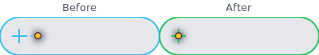

# 光学アライメント（ぼかしてそろえる）

[English](README.md) | 日本語

中央に置いたはずのアイコンや文字が、なんだか片側に寄って見えることがありますよね。そんなときに使えるスキルです。ボタン、ピル、チップ、FAB、角丸カードの中身を、見た目の中心に合わせます。

中身をぼかして「見た目の重さのかたまり」にし、その丸い端をコンテナの丸い端の中心に合わせます。計測スクリプトを実行すると、ずれがpxで返ってきて確認画像も出力されます。確認画像の枠が青なら位置がずれていて、緑ならそろっています。



## ほかのツールとどう使い分ける？

| ツール                                         | こんな疑問に                                     | 見るもの                             | 直し方                                                    |
| ---------------------------------------------- | ------------------------------------------------ | ------------------------------------ | --------------------------------------------------------- |
| make-interfaces-feel-better                    | UIを良く見せる細部のポイントは？（原則の一覧）   | コードと設計の原則                   | 原則を示す。計測はしない                                  |
| opticalcenter.dev（v0.2.0-alpha、2026-11時点） | このアイコン単体の見た目の中心はどこ？           | SVGアイコンのピクセルだけ            | ビルド時に中心のずれを求めて、viewBoxや配置の値に書き込む |
| このスキル                                     | このコンテナの中で、中身のかたまりをどこに置く？ | 画面上のコンテナと中身（文字も含む） | 測ったずれを、paddingやtranslateの値で返す                |

1. make-interfaces-feel-betterで、外の角丸 = 内の角丸 + paddingのような原則に沿っているかをチェックする
2. opticalcenter.devで、アイコンの形そのものの偏り（再生ボタンの三角など）を直す
3. このスキルで、コンテナの丸い端を基準に、そのアイコンや文字をどこに置くかを測って直す
- 正方形のアイコンボタンで、気になるのがアイコンの偏りだけなら → opticalcenter.devだけでOK
- テキストを含む場合や、左右に寄せて置く中身がある場合、ピルやチップの端に配置する場合 → このスキルが必要

## 入れ方

skills CLIを使う場合：

```bash
npx skills add yukimasaki/optical-blur-alignment
```

手でcloneして入れるなら、`skills/optical-blur-alignment`を、使っているエージェントのスキルフォルダにコピーしてください。

```bash
git clone https://github.com/yukimasaki/optical-blur-alignment.git
cp -R optical-blur-alignment/skills/optical-blur-alignment <your-skills-directory>/
```

## 必要なもの

- Node.js 23.6以降、またはBun（Node.jsではTypeScriptのスクリプトをtype strippingで実行します）
- Playwright用のChromiumブラウザ

スキルのルート（`SKILL.md`と`package.json`がある場所）で、依存パッケージとChromiumをこの順にインストールします。先に`npm install`しておくと、入れたPlaywrightの版に合ったChromiumが入ります。

```bash
npm install
npx playwright install chromium
```

`npx skills add`で入れたときは、インストール先のスキルフォルダで実行してください。

## 使い方

手順をひととおり知りたいときは[SKILL.md](skills/optical-blur-alignment/SKILL.md)を読んでください。計測はスキルのルートで、こんな感じで実行します。

```bash
node scripts/measure.ts \
  --url http://localhost:3000/your-page \
  --selector '.chip .icon' \
  --container '.chip' \
  --radius 20 --padding-x 16 --padding-y 0 --edge left \
  --output /path/to/a/temp/folder/icon.png \
  --plain-output /path/to/a/temp/folder/icon-plain.png
```

`node`の代わりに`bun`でも動きます。Playwrightがブラウザを見つけられないときは、`--browser`か`OPTICAL_BLUR_BROWSER`でブラウザの実行ファイルを指定してください。

| オプション                    | 用途                                                                                        |
| ----------------------------- | ------------------------------------------------------------------------------------------- |
| `--padding-x`、`--padding-y`  | 左右と上下のpaddingを別々に渡す。`--padding`なら両方に適用                                  |
| `--selector`                  | ぼかす中身。省略すると、コンテナ内の残りの要素を全部ぼかす（このときは`--container`が必須） |
| `--hide <selector>`           | 計測中に隠す兄弟要素（テキストだけを測るときにアイコンを隠す用途など）                      |
| `--edge left\|right`          | どちらの丸い端に合わせるか                                                                  |
| `--output`、`--plain-output`  | ぼかした確認画像と、ぼかしなしのスクリーンショット                                          |
| `--tolerance`、`--blur-ratio` | 許容するずれ（デフォルトは2px）と、ぼかしの比率（デフォルトは0.1）                          |

## クレジット

この手順は、[@Kubai087](https://x.com/Kubai087)さんが投稿した短い動画で実演されていたアイデアがもとになっています。

https://x.com/i/status/2122514434069537097

[opticalcenter.dev](https://opticalcenter.dev/)・[make-interfaces-feel-better](https://github.com/jakubkrehel/make-interfaces-feel-better)

冒頭の画像の飛行機のアイコンは、[Lucide](https://lucide.dev/)の`plane`（ISC License）です。

## ライセンス

MITです。くわしくは[LICENSE](LICENSE)をどうぞ。
