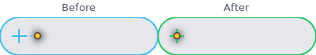

# Optical Blur Alignment

English | [日本語](README.ja.md)

Ever centered an icon or a label, only to have it still look pushed to one side? This skill helps the content of a button, pill, chip, FAB, or rounded card look centered.

Blur the content into a blob of perceived weight, then align the blob's rounded end with the center of the container's rounded end. Run the measurement script and you get the offset in pixels plus a verification image: a blue frame means it's off, a green one means it's aligned.



## How it fits with other tools

| Tool | Question it answers | What it looks at | How it fixes things |
|---|---|---|---|
| make-interfaces-feel-better | Which details make a UI look good? (a list of principles) | Code and design principles | Gives you the principles. Does not measure |
| opticalcenter.dev (v0.2.0-alpha, as of 2026-11) | Where is the visual center of this icon on its own? | Only the pixels of SVG icons | Finds the center offset at build time and writes it into the viewBox or placement values |
| This skill | Where should the content blob sit inside this container? | The rendered container and content, text included | Returns the measured offset as padding or translate values |

1. Use make-interfaces-feel-better to check that your UI follows its principles, such as outer radius = inner radius + padding
2. Use opticalcenter.dev to fix any lopsidedness in the icon shape itself (a play triangle, for example)
3. Use this skill to measure where that icon or text should sit relative to the container's rounded end, and fix it

- Square icon button where the only problem is a lopsided icon → opticalcenter.dev is all you need
- Working with text, left- or right-aligned content, or something at the end of a pill or chip → you need this skill

## Install

With the skills CLI:

```bash
npx skills add yukimasaki/optical-blur-alignment
```

Or clone the repository and copy `skills/optical-blur-alignment` into your agent's skills directory:

```bash
git clone https://github.com/yukimasaki/optical-blur-alignment.git
cp -R optical-blur-alignment/skills/optical-blur-alignment <your-skills-directory>/
```

## Requirements

- Node.js 23.6 or newer (the script uses TypeScript type stripping), or Bun
- A Chromium browser for Playwright: `npx playwright install chromium`

Install the dependencies in the skill root, the directory with `SKILL.md` and `package.json`:

```bash
npm install
```

If you installed the skill with `npx skills add`, run this inside the installed skill directory instead.

## Usage

Read [SKILL.md](skills/optical-blur-alignment/SKILL.md) for the full procedure. Run the script from the skill root:

```bash
node scripts/measure.ts \
  --url http://localhost:3000/your-page \
  --selector '.chip .icon' \
  --container '.chip' \
  --radius 20 --padding-x 16 --padding-y 0 --edge left \
  --output /path/to/a/temp/folder/icon.png \
  --plain-output /path/to/a/temp/folder/icon-plain.png
```

Use `bun` in place of `node` if you prefer. Pass `--browser` or set `OPTICAL_BLUR_BROWSER` when Playwright cannot find a browser.

| Option | Purpose |
|---|---|
| `--padding-x`, `--padding-y` | Horizontal and vertical padding separately (`--padding` sets both). |
| `--selector` | Content to blur. Omit it to blur everything left in the container. |
| `--hide <selector>` | Sibling element to hide while measuring (for example, the icon when measuring bare text). |
| `--edge left\|right` | Which rounded end of the container to align with. |
| `--output`, `--plain-output` | Blurred verification image and unblurred screenshot. |
| `--tolerance`, `--blur-ratio` | Alignment tolerance in px (default 2) and blur ratio (default 0.1). |

## Credits

The procedure is based on an idea demonstrated in a short video posted by [@Kubai087](https://x.com/Kubai087):

https://x.com/i/status/2122514434069537097

[opticalcenter.dev](https://opticalcenter.dev/) · [make-interfaces-feel-better](https://github.com/jakubkrehel/make-interfaces-feel-better)

The plane icon in the image at the top is [Lucide](https://lucide.dev/)'s `plane` (ISC License).

## License

MIT. See [LICENSE](LICENSE).
